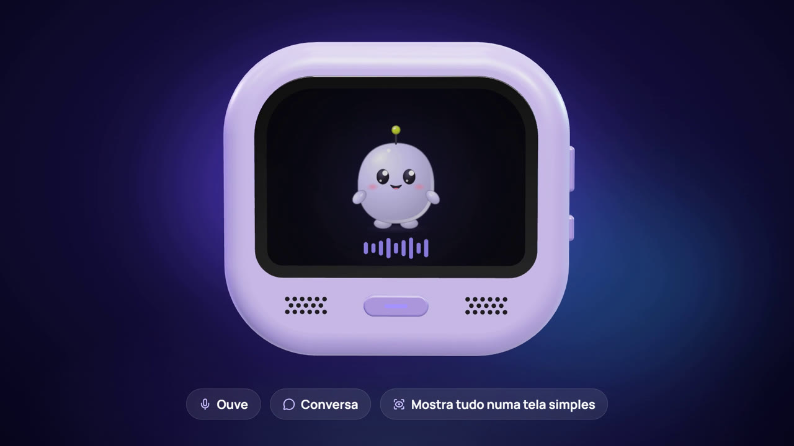
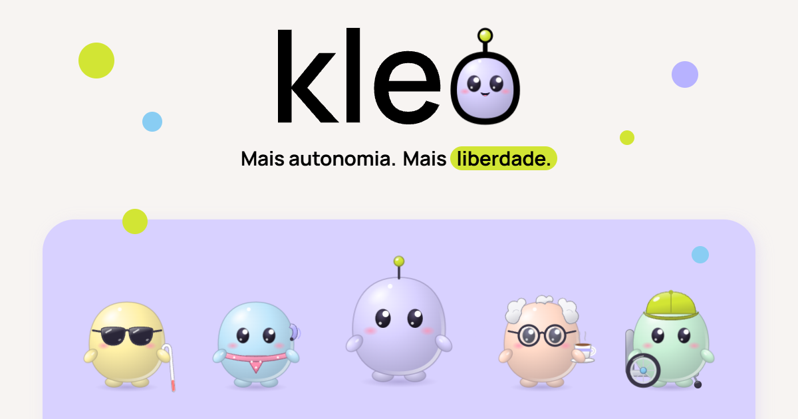
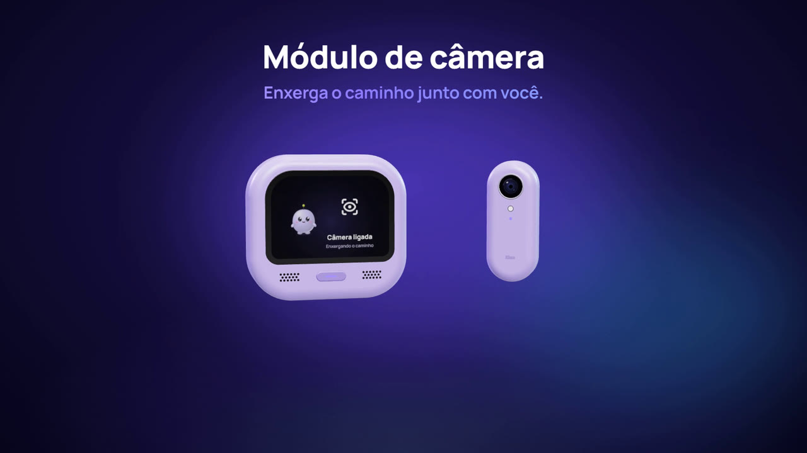
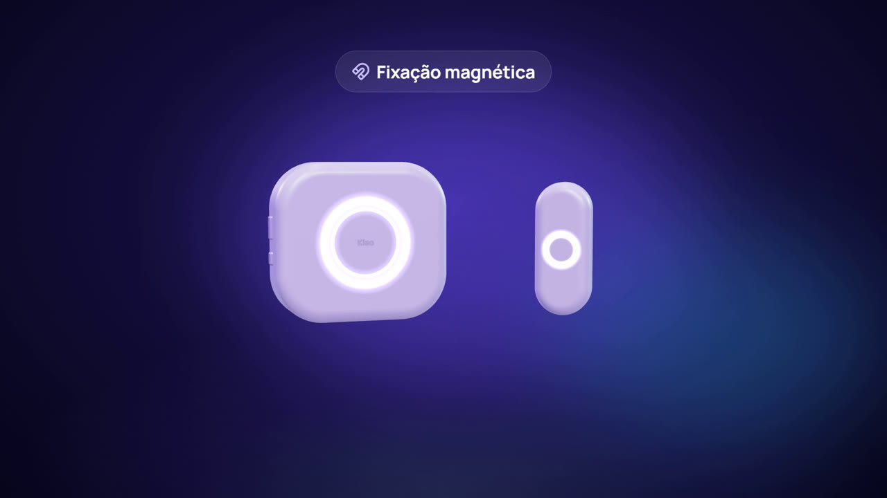
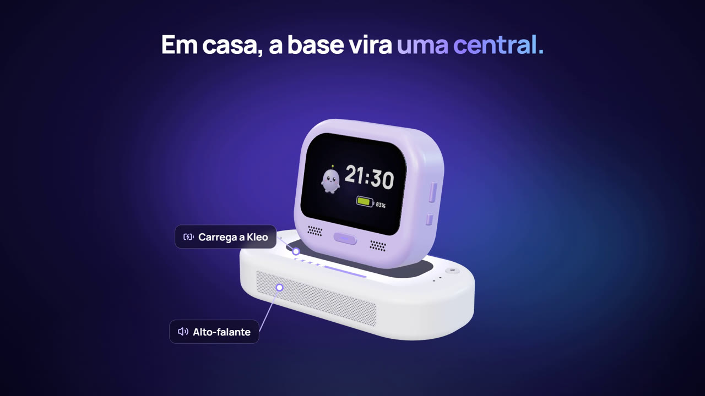
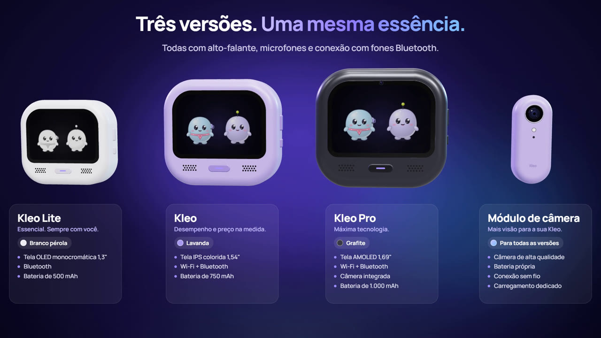
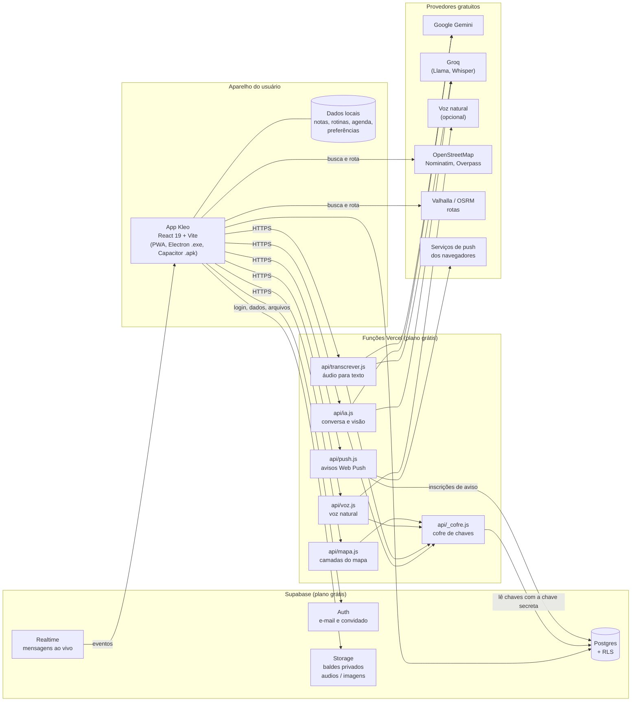

<div align="center">


# Kleo

### Mais autonomia. Mais liberdade.

Assistente pessoal com inteligência artificial para **idosos**, **pessoas com deficiência** e **qualquer pessoa**.
Projeto da **Global Solution FIAP 2026, tema CitizenTech**, desenvolvido pela empresa fictícia **Kheo**.


**[Assistir ao vídeo pitch](https://youtu.be/PQPdgAHGIkM)** ·
**[Abrir o app](https://kleo-app-xi.vercel.app)** ·
**[Baixar a Kleo (Releases)](https://github.com/brunoosz/Kleo/releases)** ·
**[Código-fonte](https://github.com/brunoosz/Kleo)**





</div>

---

## Identificação

| Campo | Informação |
|---|---|
| Instituição | FIAP |
| Curso | Engenharia da Computação, 1º ano |
| Turma | 1ECR |
| Atividade | Global Solution 2026, tema CitizenTech |
| Integrantes | Bruno Ridolfi Camperlingo Silveira Carneiro, Diego Silveira Carbonieri e Matheus Henrique Marins Vieira |
| Vídeo pitch (3 min) | [youtu.be/PQPdgAHGIkM](https://youtu.be/PQPdgAHGIkM) |
| App publicado | [kleo-app-xi.vercel.app](https://kleo-app-xi.vercel.app) |
| Código-fonte | [github.com/brunoosz/Kleo](https://github.com/brunoosz/Kleo) |
| Versão | 1.0.0 |

---

## Sumário

1. [Sobre o projeto](#1-sobre-o-projeto)
2. [Como a Kleo responde ao desafio CitizenTech](#2-como-a-kleo-responde-ao-desafio-citizentech)
3. [O dispositivo Kleo](#3-o-dispositivo-kleo)
4. [Funcionalidades](#4-funcionalidades)
5. [Acessibilidade](#5-acessibilidade)
6. [Arquitetura](#6-arquitetura)
7. [Tecnologias](#7-tecnologias)
8. [Segurança e privacidade](#8-segurança-e-privacidade)
9. [Downloads](#9-downloads)
10. [Como instalar](#10-como-instalar)
11. [Como rodar o código](#11-como-rodar-o-código)
12. [Configuração do backend](#12-configuração-do-backend)
13. [Estrutura de pastas](#13-estrutura-de-pastas)
14. [Testes realizados](#14-testes-realizados)
15. [Limitações conhecidas e próximos passos](#15-limitações-conhecidas-e-próximos-passos)
16. [Créditos e licença](#16-créditos-e-licença)
17. [Integrantes](#17-integrantes)

---

## 1. Sobre o projeto

### 1.1 A Global Solution e o tema CitizenTech

A Global Solution 2026 da FIAP propõe o tema **CitizenTech**: tecnologias criadas a partir das
**necessidades reais das pessoas**, que melhorem a vida nas cidades, no campo ou em comunidades
remotas. A proposta oficial pede que o cidadão fique **no centro da inovação**, que a necessidade
seja entendida **antes** da escolha da tecnologia e que a solução combine **tecnologia, viabilidade
e impacto**, reduzindo desigualdades no acesso a serviços, informação, mobilidade, saúde e educação.

Entre os eixos sugeridos pela FIAP estão, de forma explícita, **"tecnologias de apoio a idosos e
pessoas com deficiência"**, **"rotas urbanas acessíveis"**, **"saúde preventiva"**,
**"assistentes digitais"** e **"soluções comunitárias de segurança e comunicação"** em emergências.
A Kleo foi pensada para atender a todos esses eixos em um único aplicativo.

Referência: [experience.fiap.com.br/global-solution-citizen-tech](https://experience.fiap.com.br/global-solution-citizen-tech)

### 1.2 O problema

Boa parte da tecnologia do dia a dia é feita para quem enxerga bem, ouve bem, anda sem
dificuldade e já sabe usar um celular. Quem está fora desse perfil enfrenta barreiras diárias:

- **Idosos** se perdem em menus pequenos, esquecem remédios e dependem de familiares para tarefas simples.
- **Pessoas com deficiência visual** não conseguem ler placas, rótulos e embalagens sem ajuda.
- **Pessoas com deficiência auditiva** perdem áudios e ligações da família.
- **Cadeirantes e pessoas com mobilidade reduzida** recebem rotas de mapa com escadas e ladeiras.
- Em uma **emergência**, pedir ajuda e avisar a família ao mesmo tempo é difícil para todos.

Essas pessoas acabam usando vários aplicativos diferentes (lembrete, mapa, mensagens, lupa,
leitor de texto), cada um com uma lógica, ou simplesmente desistem e perdem autonomia.

### 1.3 Público

| Público | Necessidade principal |
|---|---|
| Pessoas com 60 anos ou mais | Interface simples, letras grandes, lembretes de remédios, contato fácil com a família |
| Pessoas com deficiência visual | Voz, leitura em voz alta, câmera que descreve o ambiente, alto contraste |
| Pessoas com deficiência auditiva | Tudo em texto, transcrição de áudios, alertas visuais e vibração |
| Pessoas com mobilidade reduzida | Rotas sem escadas e com menos ladeira, poucos toques para cada ação |
| Familiares e cuidadores | Saber onde a pessoa está, receber pedidos de ajuda, conversar |
| Qualquer pessoa | Assistente, agenda, notas e ferramentas de trabalho em um só lugar (desenho universal) |

### 1.4 A proposta

A **Kleo** é uma assistente pessoal que **se adapta à pessoa**, e não o contrário. No primeiro uso,
um questionário curto pergunta sobre visão, audição, mobilidade, idade e profissão; a partir das
respostas o app liga sozinho os recursos certos (modo simples, letras maiores, leitura em voz alta,
transcrição, rotas acessíveis etc.). Tudo funciona com **serviços gratuitos**, para que o custo nunca
seja a barreira: o app é gratuito para quem usa e custa R$ 0 para manter no ar.

A Kleo tem duas partes que trabalham juntas:

| Parte | O que é |
|---|---|
| **O dispositivo Kleo** | Um aparelho pequeno que a pessoa leva preso na roupa. Ela fala com a Kleo e ouve as respostas sem precisar pegar o celular. Tem tela simples, alto-falante, microfone, módulo de câmera e uma base de carregamento para casa (ver [seção 3](#3-o-dispositivo-kleo)). |
| **O app Kleo** | O aplicativo que já funciona hoje, no navegador, no Android e no Windows. É a extensão da Kleo: assistente com IA, mapa acessível, câmera guia, conversas com a família, SOS, rotinas e agenda (ver [seção 4](#4-funcionalidades)). |

Um exemplo do dia a dia, mostrado no vídeo pitch: a bisavó pede "Kleo, me ajuda a chegar na FIAP?
Vou buscar o meu neto.". A Kleo traça a rota a pé, avisa cada curva pelo alto-falante ou pelo fone e,
na chegada, a câmera guia confirma "Você chegou à FIAP". Ela então pede "Kleo, avisa o meu neto que
eu cheguei." e a Kleo manda a mensagem para o neto, sem que ela precise digitar nada.

---

## 2. Como a Kleo responde ao desafio CitizenTech

### 2.1 Perguntas da proposta oficial

| Pergunta da FIAP | Resposta da Kleo |
|---|---|
| Qual problema será resolvido? | A falta de autonomia de idosos e pessoas com deficiência no uso da tecnologia e da cidade: comunicação, deslocamento, saúde (remédios) e emergências. |
| Quem é o cidadão beneficiado? | Idosos (60+), pessoas com deficiência visual, auditiva e motora, seus familiares e cuidadores e, pelo desenho universal, qualquer pessoa. |
| Quais tecnologias serão usadas? | React 19 + Vite (PWA), Supabase (Auth, Postgres com RLS, Storage, Realtime), funções serverless na Vercel, IA gratuita (Google Gemini e Groq), mapas abertos (OpenStreetMap, Valhalla, OSRM), Web Push, Electron (Windows) e Capacitor (Android). Detalhes na [seção 7](#7-tecnologias). |
| Como a solução vai funcionar? | Um app único, instalado pelo navegador ou por instalador, que se adapta à pessoa pelo questionário e reúne assistente com IA, mapa acessível, conversas com a família, SOS, rotinas e agenda. Arquitetura na [seção 6](#6-arquitetura). |
| Quais resultados pode gerar? | Mais independência no dia a dia, menos remédios esquecidos, deslocamentos mais seguros, resposta mais rápida em emergências e menos carga sobre cuidadores. |
| Quem participará do ecossistema? | Usuários, familiares e cuidadores (conversas e SOS), serviços públicos de emergência (192, 193, 190), comunidade OpenStreetMap (dados de acessibilidade do mapa), provedores gratuitos de IA e, no futuro, ONGs, clínicas e prefeituras. |

### 2.2 Objetivos do desafio

| Objetivo da FIAP | Como a Kleo atende |
|---|---|
| Colocar o cidadão no centro da inovação | O questionário inicial adapta o app a cada pessoa; nada é obrigatório e tudo pode ser mudado em Configurações. |
| Entender a necessidade antes da tecnologia | Cada recurso nasce de uma barreira concreta (tabela da seção 1.3). A tecnologia escolhida foi a que roda de graça e em celulares simples. |
| Transformar necessidade real em solução aplicável | O app está publicado, tem instalador para Windows e Android e funciona no iPhone pelo navegador. |
| Reduzir desigualdades no acesso a serviços, informação, mobilidade, saúde e educação | Gratuito; a IA explica documentos e fotos; rota acessível; lembretes de remédios; ferramentas por profissão para trabalho e estudo. |
| Combinar tecnologia, viabilidade e impacto | Custo de operação zero (planos gratuitos), código aberto e público-alvo de milhões de brasileiros. |

### 2.3 Eixos temáticos sugeridos

| Eixo sugerido pela FIAP | Recurso da Kleo |
|---|---|
| Tecnologias de apoio a idosos e pessoas com deficiência | Modo simples para 60+, adaptações visuais, auditivas e motoras, assistente por voz, câmera que descreve |
| Rotas urbanas acessíveis (calçadas, segurança, mobilidade) | Mapa com rota a pé que evita escadas e ladeiras, perfil cadeirante, envio de localização |
| Saúde preventiva e orientação remota | Rotinas e alarmes de remédios, agenda de consultas, assistente que tira dúvidas (sem substituir o médico) |
| Assistentes digitais para documentos, direitos e benefícios | A IA lê e explica fotos de documentos, cartas e receitas em linguagem simples |
| Emergências: segurança, comunicação e coordenação | Botão SOS que avisa os contatos com a localização e liga para 192, 193 e 190 |
| Inclusão produtiva e capacitação | Mais de 130 ferramentas organizadas por profissão (comércio, construção, agricultura, educação, direito e outras) |
| Campo e comunidades remotas | App leve e instalável, funciona no navegador de celulares simples; ferramentas de agricultura e plantio |

### 2.4 Objetivos de Desenvolvimento Sustentável (ODS)

| ODS | Contribuição |
|---|---|
| **ODS 3: Saúde e bem-estar** | Lembretes de remédios e rotinas, agenda de consultas, SOS e contato rápido com a família reduzem riscos para idosos e pessoas com doenças crônicas. |
| **ODS 4: Educação de qualidade** | A IA explica conteúdos em linguagem simples, lê textos em voz alta, e as ferramentas por profissão apoiam estudo e capacitação. |
| **ODS 9: Indústria, inovação e infraestrutura** | Mostra que é possível entregar tecnologia assistiva com IA usando só infraestrutura gratuita e aberta. |
| **ODS 10: Redução das desigualdades** (principal) | Remove barreiras digitais para pessoas com deficiência e idosos (meta 10.2: inclusão social de todos, independentemente de idade ou deficiência), sem custo para o usuário. |
| **ODS 11: Cidades e comunidades sustentáveis** | Rota acessível e mapa inclusivo (meta 11.2: transporte acessível, com atenção a idosos e pessoas com deficiência; meta 11.7: espaços públicos acessíveis). |

---

## 3. O dispositivo Kleo

O celular nem sempre ajuda quem mais precisa: a tela é pequena, os menus são muitos e, na rua, a
pessoa precisa das mãos e da atenção para andar. Por isso a Kleo também é um **aparelho físico**:
pequeno, preso na roupa, que se usa **pela voz**. A pessoa fala, a Kleo responde em voz alta e mostra
o essencial numa tela simples. O app continua sendo o cérebro e a extensão da Kleo, com a IA, o mapa,
as conversas e o SOS.

<div align="center">

</div>

### 3.1 Partes do produto

| Parte | Para que serve |
|---|---|
| **Corpo da Kleo** | Tela com o mascote e informações grandes (próxima curva, lembrete, mensagem enviada), microfones para ouvir a pessoa, **alto-falante próprio** e conexão com **fones Bluetooth** para ouvir só para si. Um botão central para falar com a Kleo. |
| **Módulo de câmera** | Peça separada que **enxerga o caminho junto com a pessoa**: alimenta a câmera guia (degraus, travessias, obstáculos, "você chegou") e a leitura de placas, rótulos e remédios. Tem bateria própria, conexão sem fio e carregamento dedicado. |
| **Fixação magnética** | O corpo e o módulo de câmera **prendem na roupa com um ímã**, sem furar o tecido e sem ocupar as mãos. |
| **Base** | Em casa, a base **carrega a Kleo** e vira uma **central** com alto-falante, microfones e Wi-Fi. Mostra a hora e avisa das consultas e dos remédios, dentro e fora de casa. |

<div align="center">


<br />

</div>

### 3.2 Três versões

Todas as versões têm alto-falante, microfones e conexão com fones Bluetooth, e todas aceitam o
módulo de câmera.

| | **Kleo Lite** | **Kleo** | **Kleo Pro** | **Módulo de câmera** |
|---|---|---|---|---|
| Proposta | Essencial. Sempre com você. | Desempenho e preço na medida. | Máxima tecnologia. | Mais visão para a sua Kleo. |
| Cor | Branco-pérola | Lavanda | Grafite | Para todas as versões |
| Tela | OLED monocromática 1,3" | IPS colorida 1,54" | AMOLED 1,69" | |
| Conexão | Bluetooth | Wi-Fi + Bluetooth | Wi-Fi + Bluetooth | Sem fio |
| Câmera | Pelo módulo | Pelo módulo | Integrada | Câmera de alta qualidade |
| Bateria | 500 mAh | 750 mAh | 1.000 mAh | Própria, com carregamento dedicado |

<div align="center">

</div>

### 3.3 Como o aparelho e o app trabalham juntos

1. **Parear**: na tela inicial do app, o cartão do dispositivo procura o **Kleo Device** pelo
   Bluetooth do celular e conecta (Web Bluetooth no navegador; no Android e no iPhone, pelos ajustes
   de Bluetooth). Depois disso a Kleo fica ligada ao perfil da pessoa.
2. **Falar**: a pessoa aperta o botão ou chama "Kleo" e faz o pedido. O áudio vai pelo celular para a
   mesma IA do app, que já conhece o perfil dela (por exemplo, cadeirante ou com baixa visão).
3. **Ouvir e ver**: a resposta sai no alto-falante da Kleo ou no fone Bluetooth, e a tela mostra o
   essencial: a seta da próxima curva, a distância, o lembrete, a confirmação de uma mensagem.
4. **Agir**: os mesmos comandos de voz do app funcionam pelo aparelho:

| A pessoa diz | A Kleo faz |
|---|---|
| "Kleo, me ajuda a chegar na FIAP?" | Traça a rota a pé (acessível, se for o caso) e guia curva a curva |
| "Kleo, avisa o meu neto que eu cheguei." | Manda a mensagem para o contato, com 4 segundos para cancelar |
| "Kleo, me lembra do remédio às oito." | Cria a rotina com alarme |
| "Kleo, socorro!" | Aciona o SOS: avisa os contatos de emergência com a localização |
| "O que está escrito aqui?" | Usa o módulo de câmera para ler e explicar |

### 3.4 Situações de uso

- **Na rua**: a Kleo avisa cada curva, cada degrau e cada travessia **sem a pessoa precisar olhar para
  a tela**. Com o módulo de câmera, a câmera guia confirma o caminho e a chegada.
- **Em casa**: na base, a Kleo vira a central da casa: hora, lembretes de consultas e remédios e
  conversa por voz pelo alto-falante.
- **Com a família**: mensagens, áudios e localização vão para o app de quem cuida, que recebe também
  os pedidos de ajuda.

### 3.5 Estado atual

- O **app** está pronto e publicado (versão 1.0.0). Tudo o que o aparelho faz passa pelas funções
  que já existem nele: assistente por voz, comandos de mensagem e SOS, mapa com rota acessível,
  câmera guia, rotinas e conversas.
- O **dispositivo** é o próximo passo do produto. Nesta entrega ele foi projetado e **modelado em 3D**
  (corpo, módulo de câmera, fixação magnética, base e as três versões), e as imagens desta seção vêm
  do vídeo pitch. As especificações acima são as do projeto; as cores de cada versão foram escolhidas
  para a apresentação. A tela de pareamento por Bluetooth já está no app, pronta para o protótipo.

---

## 4. Funcionalidades

O app tem 14 telas (pasta [`src/screens`](src/screens)) e uma barra de navegação com Início, Kleo,
Mapa, Pessoas, Agenda, Notas, Rotinas, Profissão e Configurações.

### 4.1 Assistente com IA (tela "Kleo")

- **Conversa por texto** em português simples, com respostas curtas e explicadas.
- **Conversa por voz**: a pessoa fala, a Kleo transcreve, responde e lê a resposta em voz alta.
- **Câmera que descreve**: aponte para uma placa, um rótulo, um remédio, uma carta ou um ambiente
  e a Kleo descreve o que vê (útil para pessoas cegas ou com baixa visão). Há também modo de
  câmera ao vivo.
- **Vozes**: voz do próprio aparelho (grátis) ou vozes mais naturais pelo servidor (opcional).
- **Comandos por voz**: pedindo para a Kleo, ela manda mensagem ou áudio para um contato (com
  4 segundos para cancelar), lê as mensagens novas, aciona o SOS, cria lembretes e rotinas, marca
  compromissos na agenda e traça rotas no mapa.
- **Dois provedores de IA** com troca automática: se um falhar ou atingir o limite, o outro responde.
- A IA conhece o perfil da pessoa (ex.: cadeirante, baixa visão) e adapta as respostas.

### 4.2 Questionário de adaptação (onboarding)

No primeiro uso, a Kleo pergunta, em telas grandes e com poucas opções por vez:

| Pergunta | O que o app ajusta |
|---|---|
| Dificuldade para enxergar? | Letras maiores, alto contraste, leitura em voz alta, câmera que descreve |
| Dificuldade para ouvir? | Tudo em texto, transcrição automática de áudios, alertas visuais e por vibração |
| Dificuldade para se locomover? | Rotas sem escadas e com menos ladeira, botões maiores, menos gestos |
| Tem 60 anos ou mais / prefere simplicidade? | Modo simples (menos itens na tela, linguagem direta) |
| Profissão | Ferramentas de trabalho daquela área aparecem primeiro |

Depois vêm a escolha do **mascote** e um **tutorial** curto. Tudo pode ser alterado depois em Configurações.

### 4.3 Mapa com rota acessível

- Mapa **gratuito** com dados do OpenStreetMap, camadas de rua e satélite.
- Busca de endereços e de lugares próximos (farmácias, hospitais, pontos de ônibus etc.).
- **Rota a pé acessível**: o cálculo penaliza fortemente escadas (`step_penalty`) e prefere
  caminhos com menos ladeira; há perfil para cadeirantes. Se um servidor de rotas cair, outro assume.
- Navegação com voz curva a curva e envio da localização para a família.
- **Câmera guia**: durante a navegação, a câmera do celular fica aberta e a IA olha o caminho a cada
  poucos segundos, avisando "siga em frente", "pare", "cuidado: degrau", "pode atravessar" e
  "você chegou", com o mini mapa da rota e a distância até o destino.

### 4.4 Pessoas: conversas com a família

- Conversas em **tempo real** (Supabase Realtime) por **texto**, **áudio**, **foto** e **localização**.
- **Áudio com transcrição**: o botão "Ver em texto" transforma a mensagem de voz em texto
  (fundamental para pessoas surdas ou com perda auditiva).
- Fotos e áudios ficam em baldes **privados**, visíveis só para quem está na conversa.
- Busca de pessoas pelo nome ou @, contador de não lidas, apagar a própria mensagem.
- **Avisos com o app fechado** (Web Push) para mensagens e pedidos de ajuda.
- Sem Supabase configurado, a tela funciona em **modo demonstração** (contatos fictícios que respondem).

### 4.5 SOS e emergência

- Botão de emergência sempre acessível.
- Avisa os **contatos de emergência** cadastrados, com a **localização** atual.
- Atalhos para ligar para **192 (SAMU)**, **193 (Bombeiros)** e **190 (Polícia)**.

### 4.6 Rotinas, remédios e alarmes

- Rotinas diárias (remédios, água, exercícios) com horários e repetição.
- **Alarme que toca** na hora, com tela grande para confirmar ou adiar.
- Notificações locais no Android (Capacitor Local Notifications).

### 4.7 Agenda e notas

- **Agenda** com calendário mensal e compromissos (consultas, exames, aniversários).
- **Notas** com editor simples, cartões e lista.

### 4.8 Ferramentas por profissão

Mais de **130 ferramentas** organizadas por área (agricultura, alimentação, comércio, comunicação,
construção, direito, educação, engenharia, negócios, entre outras; ver [`src/data/prof`](src/data/prof)),
como calculadoras, conversores, listas e apoio ao plantio. A profissão escolhida no questionário
define o que aparece primeiro.

### 4.9 Mascotes

A Kleo tem mascotes animados (Kleo, Lumi, Echo, Vô, Ramp e outros) que dão personalidade ao app,
deixam o uso menos intimidador para quem tem receio de tecnologia e podem ser trocados a qualquer momento.

### 4.10 Contas, convidado e painel do dono

| Papel | O que pode fazer |
|---|---|
| **Convidado** | Usa o app sem e-mail e senha (login anônimo do Supabase). Ideal para testar. |
| **Usuário** | Conta com e-mail; os dados de conversa acompanham a pessoa entre aparelhos. |
| **Dono** (um único) | Acessa o **Painel do dono** e o **cofre de chaves** de API (IA e vozes). |

O cofre permite trocar as chaves de IA sem publicar o site de novo, e nenhuma conta consegue ler
as chaves de volta pelo app (ver [seção 8](#8-segurança-e-privacidade)).

### 4.11 Instalável em qualquer lugar

- **PWA**: instala pelo navegador (Android, iPhone, computador), com ícone, tela cheia e atalhos (service worker em [`public/sw.js`](public/sw.js)).
- **Windows**: instalador `.exe` (Electron).
- **Android**: `.apk` (Capacitor).
- **iPhone**: pelo Safari, "Adicionar à Tela de Início" (ver [seção 9](#9-downloads)).

---

## 5. Acessibilidade

### 5.1 Modos de uso

| Modo | Para quem | O que muda |
|---|---|---|
| Padrão | Qualquer pessoa | Todos os recursos visíveis |
| Simples (60+) | Idosos e quem prefere menos opções | Menos itens por tela, botões grandes, linguagem direta, ações principais na tela inicial |
| Visual | Baixa visão e cegueira | Letras maiores, alto contraste, leitura em voz alta, câmera que descreve |
| Auditivo | Surdez e perda auditiva | Transcrição de áudios, avisos visuais e vibração, nada depende só de som |
| Mobilidade | Cadeirantes e mobilidade reduzida | Rota sem escadas e com menos ladeira, alvos de toque grandes, menos gestos |

Os modos podem ser combinados (ex.: idoso com baixa visão).

### 5.2 Decisões de design

- **Desenho universal**: os recursos de acessibilidade são úteis para todos; ninguém precisa "se declarar" pessoa com deficiência para usá-los.
- **Alvos de toque grandes** e espaçados, pensando em tremores e pouca precisão.
- **Sempre mais de um canal**: o que é dito também é escrito, e o que é escrito pode ser ouvido.
- **Linguagem simples**: textos curtos, sem jargão técnico; a IA é instruída a responder assim.
- **Poucos passos**: cada ação importante (pedir ajuda, falar com a Kleo, falar com a família) fica a um ou dois toques.
- **Ícones acompanhados de texto** (biblioteca Lucide), em vez de ícones sozinhos.
- **Animações suaves e discretas**, sem piscar.
- **Mascote amigável** para reduzir o medo de "estragar alguma coisa".

---

## 6. Arquitetura



**Como as peças conversam**

1. O **app** é uma SPA React. A mesma base de código vira site (PWA), app do Windows (Electron) e app do Android (Capacitor).
2. O **Supabase** guarda contas, perfis, contatos, conversas e mensagens. Toda tabela tem **Row Level Security**: é o banco, e não o app, que decide quem pode ler cada linha.
3. As **funções da Vercel** (pasta [`api/`](api)) são o único lugar que usa segredos. Elas validam a origem da chamada, aplicam limite de uso por IP e escolhem o provedor de IA disponível.
4. Os **provedores gratuitos** fazem o trabalho pesado (IA, transcrição, voz, mapas, rotas).
5. Os apps instalados (.exe e .apk) usam o site publicado como servidor (variável `VITE_API_BASE`).

| Função | Arquivo | Responsabilidade |
|---|---|---|
| IA | [`api/ia.js`](api/ia.js) | Conversa e descrição de imagens, com troca entre Gemini e Groq |
| Transcrição | [`api/transcrever.js`](api/transcrever.js) | Converte áudio em texto (Whisper no Groq, Gemini como reserva) |
| Voz | [`api/voz.js`](api/voz.js) | Voz natural opcional, com limite diário de caracteres |
| Avisos | [`api/push.js`](api/push.js) | Envia Web Push de mensagens e pedidos de ajuda |
| Mapa | [`api/mapa.js`](api/mapa.js) | Entrega camadas de mapa com cache, sem expor chaves |
| Cofre | [`api/_cofre.js`](api/_cofre.js) | Lê as chaves guardadas pelo dono no banco |
| Teste do cofre | [`api/cofre-teste.js`](api/cofre-teste.js) | Confere se uma chave do cofre funciona, sem revelá-la |
| Comum | [`api/_ia-comum.js`](api/_ia-comum.js) | Origem permitida, limite por IP, tempo máximo, mascaramento de dados |

---

## 7. Tecnologias

### 7.1 Versões (de [`package.json`](package.json), app versão 1.0.0)

| Camada | Tecnologia | Versão |
|---|---|---|
| Interface | React / React DOM | ^19.3.1 |
| Rotas | React Router DOM | ^6.30.6 |
| Build | Vite | ^8.3.5 |
| Plugin React | @vitejs/plugin-react | ^6.1.2 |
| Ícones | lucide-react | ^1.68.0 |
| Backend | @supabase/supabase-js | ^2.119.0 |
| Serverless | @vercel/functions | ^3.11.1 |
| Avisos | web-push | ^4.0.0 |
| Mapas | Leaflet / React Leaflet | ^1.9.4 / ^5.0.0 |
| Mapas vetoriais | MapLibre GL / @maplibre/maplibre-gl-leaflet | ^5.24.0 / ^0.1.4 |
| Android e iOS | Capacitor (core, android, ios, cli) | ^8.6.0 |
| Plugins nativos | @capacitor/app, local-notifications, splash-screen | ^8.1.2, ^8.3.1, ^8.0.2 |
| Windows | Electron / electron-builder | ^45.2.3 / ^26.18.0 |
| Qualidade | ESLint (+ react-hooks, react-refresh) | ^10.13.0 |
| HTTPS local | @vitejs/plugin-basic-ssl | ^2.3.0 |

### 7.2 Por que tudo gratuito

O público da Kleo inclui aposentados e famílias de baixa renda. Por isso a regra do projeto foi:
**nenhum serviço pago, nenhum cartão de crédito**.

| Serviço | Uso | Plano |
|---|---|---|
| Supabase | Contas, banco, arquivos, tempo real | Grátis |
| Vercel | Site e funções serverless | Grátis (Hobby) |
| Google Gemini (AI Studio) | IA principal, visão, transcrição reserva | Grátis, sem cartão |
| Groq | IA rápida e transcrição (Whisper) | Grátis, sem cartão (opcional) |
| OpenStreetMap, Nominatim, Overpass | Mapa, busca, lugares | Livre e aberto |
| Valhalla e OSRM (servidores públicos) | Rotas a pé e acessíveis | Livre |
| Voz do aparelho (Web Speech API) | Leitura em voz alta | Grátis, embutida |
| Web Push (VAPID) | Avisos com o app fechado | Grátis |
| GitHub Actions | Gera o .exe e o .apk na nuvem | Grátis em repositório público |

---

## 8. Segurança e privacidade

| Medida | Como funciona |
|---|---|
| **Row Level Security (RLS)** | Ligada em todas as tabelas do [`supabase/schema.sql`](supabase/schema.sql). Cada pessoa só lê e altera o que é dela; mensagens só são vistas pelos participantes da conversa. |
| **Chaves só no servidor** | Chaves de IA, a chave secreta do Supabase e a chave privada VAPID ficam apenas nas funções da Vercel. No navegador vão só as chaves públicas (prefixo `VITE_`). |
| **Cofre do dono** | As chaves de API podem ser guardadas no banco, numa tabela que nenhuma conta lê pelo app; só o servidor, com a chave secreta, as consulta. Existe um único dono, definido no banco. |
| **Funções internas protegidas** | Funções sensíveis ficam no esquema `privado`, que não aparece na API pública do Supabase. |
| **Arquivos privados** | Baldes `audios` e `imagens` privados, até 5 MB por arquivo, só para membros da conversa; apagar, só quem enviou. |
| **Convidado** | Login anônimo: dá para usar sem fornecer e-mail. Qualquer pessoa pode apagar a própria conta (`apagar_minha_conta()`). |
| **Dados locais** | Notas, rotinas, agenda e preferências ficam no próprio aparelho. |
| **Proteção das funções** | Verificação de origem (`KLEO_ORIGENS`), limite de uso por IP, tempo máximo por chamada e mascaramento de dados em logs. |
| **Cabeçalhos HTTP** | `X-Content-Type-Options: nosniff` e `Referrer-Policy` definidos em [`vercel.json`](vercel.json). |
| **Segredos fora do Git** | `.env.local` é ignorado pelo `.gitignore`; o repositório só tem o modelo [`.env.example`](.env.example). |

A IA da Kleo **não substitui** médicos, advogados ou serviços de emergência; o app sempre oferece
os números 192, 193 e 190.

---

## 9. Downloads

Todos os arquivos ficam em **[github.com/brunoosz/Kleo/releases](https://github.com/brunoosz/Kleo/releases)**.

| Plataforma | Arquivo | Observação |
|---|---|---|
| **Windows 10/11** | `Kleo-Setup-1.0.0.exe` | Instalador. Cria atalho na área de trabalho e no menu Iniciar. |
| **Android** | `Kleo-1.0.0.apk` | App assinado. Instalar permitindo "fontes desconhecidas". |
| **iPhone / iPad** | Sem arquivo | Pelo Safari, no site publicado: Compartilhar > "Adicionar à Tela de Início". |
| **Navegador (qualquer aparelho)** | Sem arquivo | Abrir o site publicado e, se quiser, instalar como app (PWA). |

**Por que não há arquivo para iPhone?** A Apple só permite instalar apps de terceiros pela App Store
ou pelo TestFlight, e ambos exigem a **conta de desenvolvedor paga (cerca de US$ 99 por ano)** e um
Mac com Xcode. Com conta gratuita, o app só roda no iPhone do próprio desenvolvedor, ligado ao Mac,
e expira em 7 dias. Como o projeto tem custo zero, no iPhone a Kleo é usada como **PWA**: abre em
tela cheia, com ícone na tela inicial e avisos (iOS 16.4 ou mais novo). O projeto nativo para iOS
existe na pasta `ios/` e pode ser compilado com `npm run app:ios` por quem tiver a conta.

---

## 10. Como instalar

### 10.1 Windows (.exe)

1. Baixe `Kleo-Setup-1.0.0.exe` na página de [Releases](https://github.com/brunoosz/Kleo/releases).
2. Dê dois cliques no arquivo.
3. O Windows mostra o aviso azul do **SmartScreen** ("O Windows protegeu o computador"), porque o
   instalador não tem assinatura digital paga. Clique em **Mais informações** e depois em
   **Executar assim mesmo**.
4. Siga o instalador: **Avançar > Instalar > Concluir**.
5. Abra a Kleo e permita **microfone, câmera e notificações** quando o Windows perguntar.

Para atualizar, instale a versão nova por cima; os dados continuam.

### 10.2 Android (.apk)

1. No celular, baixe `Kleo-1.0.0.apk` na página de [Releases](https://github.com/brunoosz/Kleo/releases).
2. Toque no arquivo. O Android avisa que não pode instalar apps de **fontes desconhecidas**.
3. Toque em **Configurações**, ligue **Permitir desta fonte** (ou "Instalar apps desconhecidos") e volte.
4. Toque em **Instalar**. Se o **Play Protect** disser que o app é desconhecido: **Mais detalhes > Instalar mesmo assim**.
5. Abra a Kleo e permita **microfone, câmera, localização e notificações**.

### 10.3 iPhone e iPad

1. Abra o site publicado da Kleo no **Safari**.
2. Toque em **Compartilhar** (quadrado com seta para cima).
3. Toque em **Adicionar à Tela de Início** e em **Adicionar**.
4. Abra a Kleo pelo ícone. Para receber avisos, ative-os dentro do app (iOS 16.4 ou mais novo).

### 10.4 Navegador (computador ou Android)

1. Abra o site publicado no Chrome ou no Edge.
2. Clique em **Instalar** na barra de endereço (ou no botão de instalar dentro da Kleo).

### 10.5 Primeiro uso

1. Entre como **convidado** (sem e-mail) ou crie uma conta.
2. Responda ao questionário (visão, audição, mobilidade, idade, profissão).
3. Escolha um mascote e veja o tutorial.
4. Em **Pessoas**, adicione os contatos de emergência para o SOS.

---

## 11. Como rodar o código

### 11.1 Requisitos

| Item | Versão | Para quê |
|---|---|---|
| Node.js | 20 ou mais novo (o CI usa 24) | Rodar e compilar o app |
| npm | O que vem com o Node | Instalar dependências |
| Git | Qualquer | Clonar o repositório |
| JDK 21 + Android SDK | Opcional | Gerar o `.apk` |
| Mac com Xcode | Opcional | Gerar o app de iOS |

### 11.2 Passo a passo

```bash
git clone https://github.com/brunoosz/Kleo.git
cd Kleo
npm install
cp .env.example .env.local     # no Windows (PowerShell): Copy-Item .env.example .env.local
# preencha o .env.local (veja a tabela abaixo)
npm run dev
```

Abra o endereço mostrado no terminal (normalmente `http://localhost:5173`).

**Sem preencher nada**, o app já abre: as telas locais (notas, rotinas, agenda, mapa, ferramentas)
funcionam e a tela Pessoas entra em modo demonstração. A IA precisa de pelo menos a `GEMINI_API_KEY`
e de um ambiente que rode as funções de `api/` (o site publicado na Vercel ou `npx vercel dev`).

### 11.3 Variáveis de ambiente (`.env.local`)

| Variável | Tipo | Para quê |
|---|---|---|
| `VITE_SUPABASE_URL` | Pública | Endereço do projeto Supabase |
| `VITE_SUPABASE_ANON_KEY` | Pública | Chave publishable/anon (nunca a secret) |
| `VITE_VAPID_PUBLIC_KEY` | Pública | Chave pública dos avisos |
| `VITE_API_BASE` | Pública | Endereço do site publicado (usado pelos apps .exe e .apk) |
| `GEMINI_API_KEY` | Segredo | IA principal |
| `GROQ_API_KEY` | Segredo (opcional) | IA rápida e transcrição |
| `SUPABASE_SERVICE_ROLE_KEY` | Segredo | Usada só pelo servidor (avisos e cofre) |
| `VAPID_PRIVATE_KEY` | Segredo | Chave privada dos avisos |
| `VAPID_SUBJECT` | Segredo | Contato `mailto:` do responsável pelos avisos |
| `KLEO_ORIGENS` | Opcional | Outros domínios autorizados a usar a IA |

As chaves de IA também podem ser guardadas no **cofre do dono**, dentro do app; o `.env.local` fica como reserva.

### 11.4 Scripts

| Comando | O que faz |
|---|---|
| `npm run dev` | Servidor de desenvolvimento (Vite) |
| `npm run celular` | Servidor com HTTPS na rede local, para testar câmera e microfone no celular |
| `npm run build` | Gera a versão de produção em `dist/` |
| `npm run preview` | Serve a pasta `dist/` localmente |
| `npm run lint` | Verifica o código com ESLint |
| `npm run app:pc` | Gera o instalador do Windows (`release/Kleo-Setup-1.0.0.exe`) |
| `npm run app:pc:dev` | Abre o app do Windows usando o servidor de desenvolvimento |
| `npm run app:android` | Gera os `.apk` (assinado e de teste) em `release/` |
| `npm run app:android:teste` | Gera só o `.apk` de teste |
| `npm run app:ios` | Compila e sincroniza o projeto iOS (precisa de Mac) |

O workflow [`.github/workflows/apps.yml`](.github/workflows/apps.yml) gera o `.exe` e o `.apk` na
nuvem do GitHub e, ao criar uma tag `v*`, publica uma Release com os arquivos.

---

## 12. Configuração do backend

Resumo (cerca de 1 hora, tudo grátis e sem cartão):

1. **Supabase**: criar o projeto (região São Paulo), rodar [`supabase/schema.sql`](supabase/schema.sql) no SQL Editor, ligar o login anônimo e copiar a URL e as chaves.
2. **IA**: criar a chave grátis do Gemini (e, opcionalmente, a do Groq).
3. **Avisos**: gerar o par VAPID com `npx web-push generate-vapid-keys`.
4. **Publicar**: importar o repositório na Vercel e cadastrar as variáveis.
5. **Dono**: criar a conta, virar dono e guardar as chaves no cofre.

Documentação detalhada:

- [`SUPABASE.md`](SUPABASE.md): estrutura do banco, regras RLS, RPCs, Storage e Realtime.
- [`kit/00-LEIA-PRIMEIRO.txt`](kit/00-LEIA-PRIMEIRO.txt): índice do kit com 14 guias passo a passo, com o nome exato de cada botão.
- [`kit/12-PARA-PROFESSORES-E-TESTADORES.txt`](kit/12-PARA-PROFESSORES-E-TESTADORES.txt): texto para quem vai avaliar e testar.
- [`kit/14-INSTALADORES-PC-ANDROID-IPHONE.txt`](kit/14-INSTALADORES-PC-ANDROID-IPHONE.txt): como gerar e instalar o .exe, o .apk e o iPhone.
- [`kit/modelo-env-local.txt`](kit/modelo-env-local.txt): modelo completo do `.env.local`.

**Caminho mais curto**: só a chave do Gemini e a publicação na Vercel já deixam a Kleo conversando;
sem Supabase, a tela Pessoas funciona em modo demonstração.

---

## 13. Estrutura de pastas

```
kleo-app/
├── docs/dispositivo/      Imagens do dispositivo Kleo usadas neste README
├── api/                    Funções serverless da Vercel (IA, transcrição, voz, push, mapa, cofre)
├── android/                Projeto Android gerado pelo Capacitor
├── ios/                    Projeto iOS gerado pelo Capacitor
├── electron/               App do Windows (janela principal, preload, configuração do instalador)
├── kit/                    Guias passo a passo (00 a 14), modelo de .env e cópia do SQL
├── LICENCA/                Termos de uso (TERMOS.txt)
├── public/                 Ícones, manifesto PWA, service worker, imagem de divulgação
├── scripts/                Script que gera o .apk
├── src/
│   ├── App.jsx             Rotas e estrutura geral
│   ├── main.jsx            Ponto de entrada do React
│   ├── screens/            14 telas (Home, Chat, Mapa, Pessoas, Agenda, Notas, Rotinas, ...)
│   ├── components/         Componentes (SOS, alarmes, mapa, mascote, painel do dono, ...)
│   ├── ferramentas/        Ferramentas por profissão
│   ├── data/               Mascotes, profissões, cidades, menu de navegação
│   ├── hooks/              Hooks React reutilizáveis
│   ├── lib/                IA, perfil, alarmes, lugares, Supabase e utilidades
│   └── styles/             Estilos
├── supabase/schema.sql     Banco completo: tabelas, RLS, gatilhos, RPCs, Storage, Realtime, cofre
├── .github/workflows/      Geração automática do .exe e do .apk
├── .env.example            Modelo das variáveis de ambiente
├── SUPABASE.md             Documentação do backend
├── vercel.json             Configuração de publicação e cabeçalhos
├── capacitor.config.json   Configuração do app móvel
└── package.json            Dependências e scripts
```

---

## 14. Testes realizados

| Área | Como foi testado | Resultado |
|---|---|---|
| Banco (RLS, gatilhos, RPCs, Storage, idempotência) | [`supabase/schema.sql`](supabase/schema.sql) executado em um Postgres real (**PGlite**) com imitações do Supabase (papéis, `auth.uid()`, Storage) | **106 verificações** aprovadas, incluindo contas, papéis e cofre; script rodado várias vezes, com e sem dados, sem erro |
| Lógica do cliente | Testes de funções do app (rotinas, alarmes, agenda, perfil, adaptação pelo questionário) | Aprovados |
| Telas | Testes em navegador sem interface (headless): navegação pelas rotas, onboarding, modo simples | Sem erros de execução |
| Qualidade do código | `npm run lint` (ESLint) e `npm run build` | Sem erros |
| Instaladores | Geração do `.exe` e do `.apk` | Gerados |

**O que não foi testado com serviços reais (honestidade):**

- Carga com muitos usuários simultâneos no Supabase e na Vercel (limites dos planos grátis).
- Avisos com o app fechado (Web Push) em todos os navegadores e versões de iOS.
- Testes de usabilidade com grupos reais de idosos e pessoas com deficiência em número representativo.
- Leitores de tela (TalkBack, VoiceOver, NVDA) em todas as telas.
- O app nativo de iPhone, que não pode ser assinado sem a conta paga da Apple.
- Disponibilidade dos servidores públicos de rota (Valhalla/OSRM) e qualidade dos dados de acessibilidade do OpenStreetMap em cada bairro.

---

## 15. Limitações conhecidas e próximos passos

### Limitações

- **Planos gratuitos** têm limites (requisições de IA por minuto, tamanho do banco; o projeto Supabase grátis pausa após um período sem uso).
- **Avisos com o app fechado** não funcionam dentro do `.exe` e do `.apk` (usam o Web Push do navegador); com o app aberto funcionam normalmente. Quem precisa deles deve instalar pela web.
- **iPhone** só como PWA, por causa do custo da conta Apple.
- **Instaladores sem assinatura paga** geram os avisos do SmartScreen e do Play Protect.
- A **rota acessível** depende de os dados do OpenStreetMap estarem completos (escadas, rampas, inclinação).
- A IA pode errar; ela não substitui profissionais de saúde nem serviços de emergência.
- Notas, rotinas e agenda ficam só no aparelho (não sincronizam entre dispositivos).

### Próximos passos

1. Protótipo físico do dispositivo Kleo (corpo, módulo de câmera e base), pareado com o app por Bluetooth.
2. Testes de usabilidade com idosos e pessoas com deficiência, em parceria com ONGs e centros de convivência.
3. Sincronizar notas, rotinas e agenda na nuvem (opcional, com RLS).
4. Detecção de queda pelo acelerômetro, com SOS automático.
5. Contribuir de volta com o OpenStreetMap: usuários marcando calçadas, rampas e escadas.
6. Integração com transporte público acessível e serviços públicos (agendamentos, benefícios).
7. Suporte a Libras (vídeos ou avatar) e a outros idiomas.
8. Publicação na Play Store e na App Store com patrocínio ou parceria.

---

## 16. Créditos e licença

- **Licença e termos de uso**: ver [`LICENCA/TERMOS.txt`](LICENCA/TERMOS.txt). Uso gratuito para fins pessoais, testes e avaliação acadêmica; venda e redistribuição modificada não são permitidas. Os nomes Kleo e Kheo, o logotipo e os mascotes pertencem aos autores.
- **Mapas**: © colaboradores do [OpenStreetMap](https://www.openstreetmap.org/copyright) (ODbL); rotas por Valhalla e OSRM.
- **IA**: Google Gemini e Groq, pelos planos gratuitos.
- **Ícones**: [Lucide](https://lucide.dev) (licença ISC).
- **Infraestrutura**: Supabase, Vercel e GitHub Actions.
- **Bibliotecas**: React, Vite, Leaflet, MapLibre, Capacitor, Electron e as demais listadas no `package.json`, cada uma sob sua própria licença.
- **Proposta do desafio**: FIAP, Global Solution 2026, CitizenTech.

---

## 17. Integrantes

Turma **1ECR**, Engenharia da Computação, 1º ano, FIAP.

| Integrante |
|---|
| Bruno Ridolfi Camperlingo Silveira Carneiro |
| Diego Silveira Carbonieri |
| Matheus Henrique Marins Vieira |

Empresa (fictícia): **Kheo** · Repositório: [github.com/brunoosz/Kleo](https://github.com/brunoosz/Kleo)

<div align="center">

**Kleo, da Kheo. Mais autonomia. Mais liberdade.**

</div>
